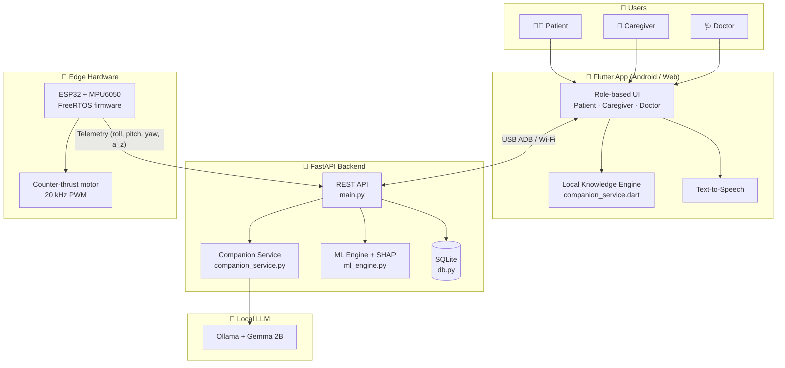
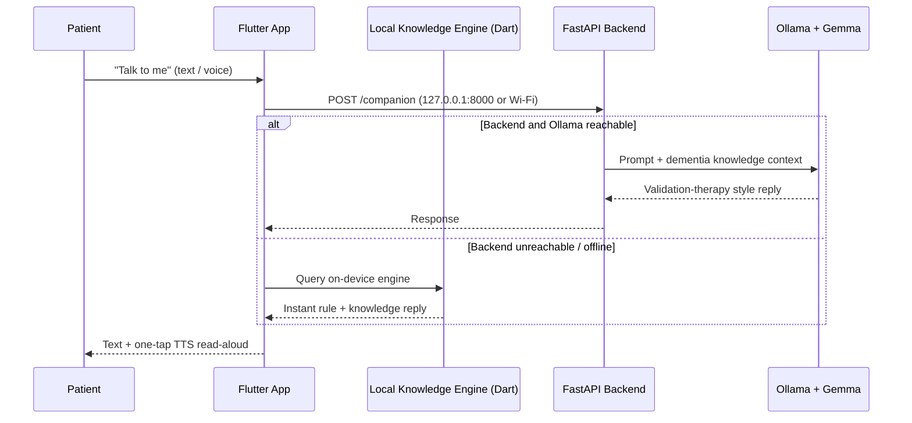
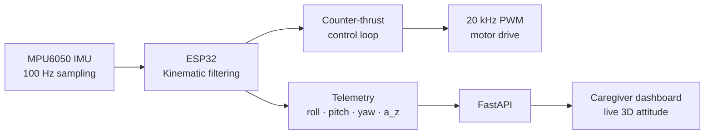

<div align="center">

# 🌿 SAHAYAK-AI (सहायक)

### AI-Based Cognitive Gaming, Neural Conversational Companion & Memory Assistance Platform for Elderly Dementia Patients in North Eastern Region (NER)

**Offline-First · Multilingual & NER Regional Context · Dual-Tier On-Device Knowledge Engine & Ollama LLM · ML Biomarker Analysis & SHAP Explainability · Active Kinematic ESP32 Tremor Stabilization**

[](https://flutter.dev)
[](https://fastapi.tiangolo.com)
[](https://ollama.com)
[](https://ai.google.dev/gemma)
[](https://www.sqlite.org)
[](https://www.espressif.com/en/products/socs/esp32)
[](https://shap.readthedocs.io)
[](https://www.sih.gov.in)
[](LICENSE)

[🚀 Quick Start](#-quick-start-guide) · [🏛️ Architecture](#️-system-architecture) · [✨ Features](#-tri-role-core-features--capabilities) · [📁 Structure](#-repository-structure) · [📖 API Docs](http://localhost:8000/docs)

</div>

---

## 📌 Problem Statement & Executive Summary

In India, over **8.8 million** elderly individuals live with dementia, with an estimated **200,000+ undiagnosed cases** in the North Eastern Region (NER) across Assam, Meghalaya, Manipur, Mizoram, Nagaland, Tripura, Arunachal Pradesh and Sikkim. Terrain barriers, limited clinical infrastructure and low awareness leave patients and family caregivers isolated.

**SAHAYAK-AI (सहायक)** is an offline-first, tri-role healthcare platform designed for dementia **care support** in NER and across India:

- **Comprehensive Dementia Knowledge Engine:** Built-in, fully offline engine answering questions on clinical stages ([Reisberg GDS 1–7](https://www.alz.org/alzheimers-dementia/stages)), medical management (Donepezil, Memantine, Galantamine, Rivastigmine), screening tools (MMSE, MoCA, CDT, GDS), non-pharmacological interventions and caregiver safety strategies.
- **Tri-Role Ecosystem (Patient, Caregiver, Doctor):** Tailored interfaces for patients (calming cognitive games, daily memory checklists, voice companion), caregivers (appointment booking, live telemetry, doctor directive sync) and clinicians (SHAP feature attribution, cognitive level locking, longitudinal patient history).
- **Dual-Tier AI Companion ("Talk to me"):** Runs locally on mobile and backend. Combines an instant local rule and knowledge fallback engine (`companion_service.dart` / `companion_service.py`) with local [Ollama](https://ollama.com) + [Gemma](https://ai.google.dev/gemma) LLM inference, so the companion still responds when there is no internet.
- **Hardware-Integrated Active Tremor Stabilization:** Real-time kinematic stabilization firmware using an [ESP32](https://www.espressif.com/en/products/socs/esp32) and MPU6050 IMU, delivering 20 kHz counter-thrust PWM signals for active spoon/utensil motor control.

> ⚠️ **Responsible-AI note:** SAHAYAK-AI is a **cognitive assistance, monitoring and caregiver-support platform**. It does not independently diagnose dementia. ML outputs are decision-support signals for a qualified clinician to review, and the companion is not a substitute for professional medical advice.

---

## 🏛️ System Architecture

### 1. High-level architecture



### 2. Dual-tier AI companion flow



### 3. Tremor stabilization data flow



---

## ✨ Tri-Role Core Features & Capabilities

### 🧑‍🦳 1. Patient Workspace (Serene Sage & Calming Visuals)

- **Dual-Tier AI Companion ("Talk to me")**
  - *Empathetic & validation therapy:* answers questions on dementia stages, medications, daily guidance and reminiscence prompts without reality-confrontation.
  - *Dual-IP & offline resilience:* connects to the FastAPI backend over USB ADB (`127.0.0.1:8000`) or Wi-Fi (`<your-LAN-IP>:8000`). If offline, it falls back instantly to the built-in Dart knowledge engine.
  - *Voice Text-to-Speech (TTS):* one-tap audio read-aloud for all conversational responses.
- **Gentle Cognitive Exercises**
  - *Clock Drawing Test (CDT):* interactive canvas for executive control and visuospatial orientation.
  - *Memory Match & Story Recall:* working-memory training with adaptive difficulty scaling.
  - *Spot the Difference & Local Language Naming:* cultural-context prompts tailored for NER elders.
- **Routine & Daily Reminders:** high-contrast, large-touch checklist with clear TTS audio narration.

### 👥 2. Caregiver Dashboard (Warm Terracotta & Mint)

- **Clinical Appointment Booking:** specialty selection, format choice (In-Person / Telehealth), custom slot selection and symptom notes.
- **Live Kinematic Tremor Telemetry:** real-time 3D attitude monitoring (Roll, Pitch, Yaw), vertical acceleration (a<sub>z</sub>) and 20 kHz counter-thrust PWM feedback.
- **Doctor Directive Sync:** immediate viewing of doctor prescriptions, care plans and daily cognitive activity targets.

### 🩺 3. Doctor Portal (Clinical Blue)

- **Longitudinal Patient History:** cognitive scores, exercise completion trends and clinical notes.
- **Clinical Directives & Cognitive Locking:** set patient daily goals and lock cognitive game difficulty levels.
- **ML Biomarker Assessment & SHAP Explainability:** fast classification (sub-50 ms) paired with [SHAP](https://shap.readthedocs.io) waterfall feature-attribution plots, shown as decision support for the clinician.

---

## 🧠 Clinical Knowledge Engine (Dementia & Project Intelligence)

The chatbot (Python backend + Flutter mobile app) is built with domain knowledge covering:

| Area | Coverage |
|------|----------|
| **Disease details** | Pathophysiology, [7 stages of the Reisberg GDS](https://www.alz.org/alzheimers-dementia/stages), distinction from normal aging, epidemiology in NER |
| **Subtypes** | Alzheimer's Disease, Vascular Dementia, Lewy Body Dementia (LBD), Frontotemporal Dementia (FTD), Mixed Dementia, Parkinson's Disease Dementia |
| **Pharmacological management** | AChE inhibitors (Donepezil, Rivastigmine, Galantamine) and NMDA antagonist (Memantine) |
| **Caregiver & safety** | Wandering prevention, sundowning management, communication validation rules, burnout mitigation |
| **Hardware** | ESP32 microcontroller, MPU6050 IMU (100 Hz sampling), 20 kHz PWM motor stabilization |

---

## 🎨 Visual System & Tokens

| Token | Value | Usage |
|-------|-------|-------|
| Primary Forest Green | `#124E3C` | Headings, primary CTAs, active indicators |
| Primary Dark | `#12302A` | Hover and active states |
| Accent Orange | `#D87236` | Hero highlights (used sparingly) |
| Page Background | `#F0F6F0` | Soft mint-white |
| Card Surface | `#FCFCFC` | Clean elevated surfaces |
| Clinical Accent (Doctor) | `#184ED8` on `#BAD8FC` | Text on chip |

---

## 📁 Repository Structure

```
SIH-Final-Round/
├── backend/                        # FastAPI Backend & ML Pipeline
│   ├── app/
│   │   ├── main.py                 # REST API Endpoints & FastAPI App
│   │   ├── companion_service.py    # Offline Ollama + Gemma LLM & Knowledge Engine
│   │   ├── db.py                   # SQLite Schema, Repositories & Seeding
│   │   └── ml_engine.py            # Scikit-Learn ML Model & SHAP Explainability
│   ├── shayak.db                   # SQLite Persistent Database
│   └── requirements.txt            # Python Dependencies
├── shayak_mobile/                  # Cross-Platform Flutter Frontend
│   ├── lib/
│   │   ├── models/                 # Data Models (Patient, Directives, Appointments)
│   │   ├── screens/                # Patient, Caregiver, Doctor & Auth Screens
│   │   ├── services/               # API Config, Companion Service, DB & TTS Audio
│   │   ├── theme/                  # Design Tokens & Typography System
│   │   └── widgets/                # Companion Modal, Top Bar, Sidebar & Action Cards
│   └── pubspec.yaml                # Flutter Dependencies
└── firmware/                       # Edge Hardware Firmware
    └── esp32_stabilization/        # FreeRTOS MPU6050 IMU Stabilization Firmware
```

---

## ⚡ Quick Start Guide

### Prerequisites

| Tool | Link |
|------|------|
| Python 3.10+ | [python.org](https://www.python.org/downloads/) |
| Flutter SDK | [docs.flutter.dev/get-started/install](https://docs.flutter.dev/get-started/install) |
| Ollama (optional) | [ollama.com/download](https://ollama.com/download) |
| Android Debug Bridge (ADB) | [developer.android.com/tools/adb](https://developer.android.com/tools/adb) |
| Arduino IDE / PlatformIO (firmware) | [arduino.cc](https://www.arduino.cc/en/software) · [platformio.org](https://platformio.org) |

### 1. 🐍 Backend API (FastAPI + SQLite)

```bash
# Navigate to backend
cd backend

# Install dependencies
pip install -r requirements.txt

# Start FastAPI server
python -m uvicorn app.main:app --reload --host 0.0.0.0 --port 8000
```

Interactive API docs: open (http://localhost:8000/docs)

### 2. 🤖 Local Ollama LLM Service (Optional)

```bash
# Start Ollama service
ollama serve

# Pull local Gemma model
ollama pull gemma2:2b
```

### 3. 📱 Mobile & Web App (Flutter)

```bash
# Navigate to mobile app
cd shayak_mobile

# Install dependencies
flutter pub get

# Run on Web (Chrome)
flutter run -d chrome

# Build Debug APK for Android
flutter build apk --debug --android-skip-build-dependency-validation

# Deploy directly to connected Android device
adb install -r ../build/app/outputs/flutter-apk/app-debug.apk
```

> 💡 **Connecting a phone to the backend:** over USB run `adb reverse tcp:8000 tcp:8000` and use `127.0.0.1:8000`. Over Wi-Fi, use your computer's LAN IP on the same network.

### 4. 🔧 Firmware (ESP32, optional)

Open `firmware/esp32_stabilization/` in Arduino IDE or PlatformIO, select your ESP32 board, and flash.

---

## 🔗 Links

| Resource | Link |
|----------|------|
| 📂 Source code | [github.com/Snehaa018/SIH-Final-Round](https://github.com/Snehaa018/SIH-Final-Round) |
| 👩‍💻 Author | [github.com/Snehaa018](https://github.com/Snehaa018) |
| 📖 API docs (local) | [localhost:8000/docs](http://localhost:8000/docs) |
| 🏆 Smart India Hackathon | [sih.gov.in](https://www.sih.gov.in) |


---

## ⚠️ Limitations & Disclaimer

- Not a medical device and not a diagnostic tool; all clinical decisions rest with qualified healthcare professionals.
- ML models and the knowledge engine are intended for decision support and education.
- The LLM companion can make mistakes; the offline engine is the safe fallback for medical questions.
- The tremor-stabilization hardware is a research prototype.

---

## 👥 Team

Built for **Smart India Hackathon 2026** · Team SAHAYAK-AI


<div align="center">

Made with 💚 for elderly care in North East India

</div>
